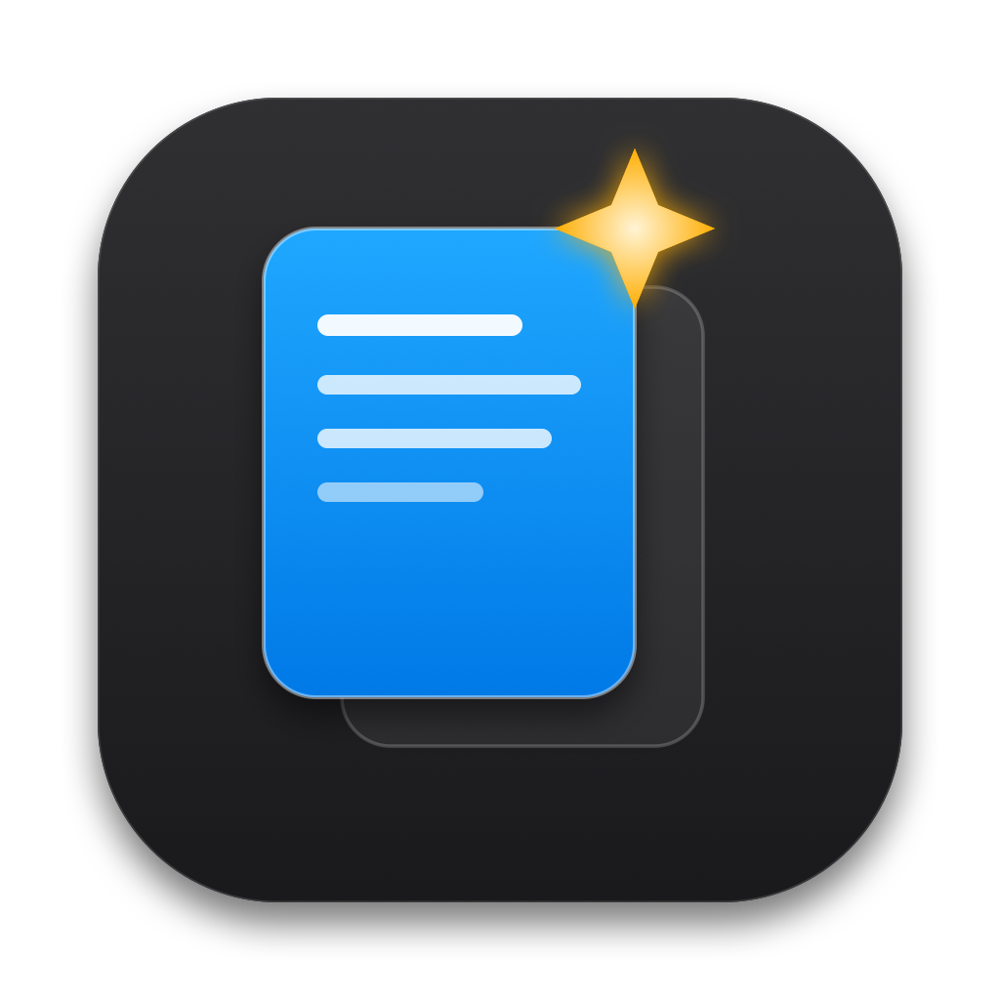

# ConCopy


ConCopy is a lightweight clipboard manager and snippet tool for macOS. It retains text, rich formatting, images, and file references, allowing you to quickly search and reuse them directly from your menu bar without cluttering the Dock.

Press **⌘⇧V** to open the panel, type to filter immediately, and hit **Enter** to paste the selected clip into your active app. The panel uses a non-activating floating HUD window to preserve your active app context.

<p align="center">
  
</p>

<!-- To add an interface preview: save the image at assets/screenshot.png -->
<!--  -->

[Installation](#installation) · [Features](#features) · [Keyboard Shortcuts](#keyboard-shortcuts) · [Support ConCopy](#support-concopy) · [Development](#development) · [Changelog](CHANGELOG.md)

---

## Installation

1. Download the latest `.dmg` from the [Releases](https://github.com/bicsurf/concopy/releases) page.
2. Open the disk image and drag **ConCopy.app** into your **Applications** folder.
3. Launch ConCopy and press **⌘⇧V** to summon the floating HUD. Global shortcuts can be customized in Settings.

**macOS 14 Sonoma or later** is required. To build from source, see the [Development](#bundle-app-and-dmg) section.

### Accessibility Permissions & Paste Modes

To paste directly into the active application, grant ConCopy accessibility permissions in **System Settings → Privacy & Security → Accessibility**.

Without accessibility permissions, selecting an item copies it to the system pasteboard so you can paste manually with **⌘V**. In ConCopy Settings, you can choose between **Paste into active app** and **Copy to clipboard**.

A simple click on a clip dismisses the panel in both modes: it pastes the clicked clip into the previous app when set to **Paste into active app**, or copies it ready for **⌘V** under **Copy to clipboard**. **⇧click**, **⌘click**, and the circular row selection indicators keep the panel open to compose multi-item selections.

---

## Features

| Feature Area | Capabilities |
| --- | --- |
| History & Search | Store text, RTF, HTML, URLs, images, and file references. Search instantly using SQLite FTS5 with deduplication. |
| Quick Filters & Dev Transforms | Filter instantly by content type (text, code, links, images, colors) and apply developer transformations (JSON format/minify, URL encode/decode, Base64, case convert, Markdown/HTML). |
| OCR & Color Swatches | Recognize text from images using Apple Vision OCR and extract color preview swatches (HEX, RGB, HSL) from text and clipboard content. |
| Paste Stack & Sequential Queue | Support for LIFO Paste Stack and FIFO Paste Queue modes to sequentially paste series of clips without reopening the HUD. |
| Dynamic Snippets | Create reusable text templates with dynamic variables (`{date}`, `{time}`, `{clipboard}`) and interactive prompt fill-ins before paste. |
| Privacy Shield & Masking | Automatic detection and masking of sensitive data (credit cards, passwords, API tokens) with biometric local unlock. |
| Contextual Positioning | Position the HUD near the active text caret, mouse pointer, or centered on screen. |
| Quick Actions & Link Previews | Run scripts, launch Terminal or browser directly from clips, and view rich web metadata previews (titles and favicons). |
| Multi-Selection & Batch Paste | Select continuous ranges or individual clips, concatenate with custom separators, or paste multi-image selections as native file objects in Finder and chat apps. |
| Favorites & Lists | Pin favorite clips, organize items into custom lists, and configure an Auto-Star list. |
| Quick Previews | View full-size text, image, and file previews directly inside the HUD. |
| Screenshot Ingestion | Automatically ingest screenshots into history once image decoding completes. |
| Maintenance & Exclusion | Pause monitoring, exclude sensitive apps, and configure automated history retention by age and count. Favorites and listed clips are protected from cleanup. |
| Import & Backup | Import existing histories from Maccy and Copy ’Em, export JSON archives, and restore data without overwriting local history. |
| iCloud Drive Sync | Sync clips, payloads, lists, and snippets privately between your Macs via your personal iCloud Drive folder. |
| Updates | Check for new GitHub releases manually or enable automated update checks. |

History rows display the exact copied content: URLs show the direct web address without downloading remote pages. Custom clip names from older database versions remain supported for search, backup, and sync, but are not displayed as row headers.

### Importing from Maccy and Copy ’Em

In **Settings → History → Import from Other Apps**, select **Import from Maccy…** or **Import from Copy ’Em…**. Both SQLite databases and directories are supported; Copy ’Em also supports native `.cep` export packages.

Imports leverage ConCopy's SHA-256 deduplication and preserve original timestamps, favorites, custom names, and lists. Duplicate merging preserves existing local metadata. A detailed summary report shows imported, merged, and skipped items.

Limits are **50 MiB per payload**, **500 MiB total per import**, and **50,000 items**. String limits are measured in bytes, including Unicode characters.

### Backup & Restore

In **Settings → History → Backup & Restore**, use **Export Archive…** and **Import Archive…**.

Restoration is additive: it keeps local data, recovers missing or damaged blobs from intact backups, and restores conflicting snippet versions under an alternative shortcut (e.g. `~restored`). Archive exports include snippet provenance and usage counters to ensure repeated restores are idempotent.

Legacy v1 and v2 archives remain readable. Local database schema migrations up to v8 are applied automatically on database launch.

### iCloud Drive Synchronization

Enable **iCloud Drive Sync** in ConCopy Settings across your Macs. Shared sync state is stored in:

```text
~/Library/Mobile Documents/com~apple~CloudDocs/ConCopy/sync-state-v2.json
```

Format v2 syncs payloads while preserving stable identifiers, aliases, and deletions. Metadata revisions (favorites, custom names, lists) have independent clocks from content revisions: re-copying a clip does not overwrite remote metadata edits.

The legacy `sync-state-v1.json` is automatically read for migration and left untouched. Synchronization is designed for convenience and does not replace regular backups.

### Local Data & Privacy

Data is stored locally under:

```text
~/Library/Application Support/ConCopy/
├── concopy.sqlite
└── blobs/             # External payloads, addressed by SHA-256
```

ConCopy strictly ignores transient, concealed, and autogenerated pasteboard types, 1Password items, and user-blacklisted applications. An internal marker prevents self-capture loopbacks. Pausing clipboard monitoring also suspends screenshot ingestion.

Local history and JSON backups are stored unencrypted; use FileVault on macOS for full-disk encryption. Network activity is limited to user-enabled GitHub update checks and optional rich link previews.

If the persistent database cannot be opened at startup, ConCopy falls back to **Temporary history** in an isolated sandbox. Automated retention and sync are suspended during temporary sessions: export a backup from Settings before quitting.

---

## Keyboard Shortcuts

The table below reflects the default shortcut configuration. The **Swap numeric modifiers (⌘ ⇋ ⌘⌥)** setting swaps the numeric shortcut modifiers in Settings. Standard `Option` key combinations remain available for typing special symbols and accents; **⌥Enter** triggers plain text paste.

| Shortcut | Panel Action |
| --- | --- |
| **⌘⇧V** | Toggle HUD panel (available globally). |
| Typing | Filters clips immediately in the search field. |
| **Enter** | Pastes or copies the selected clip based on configured mode. |
| **⌥Enter** | Forces plain text paste for the selected clip. |
| **⌘C** | Copies selected clip or batch to clipboard without closing HUD. |
| **⌘⌥1…9**, **⌘⌥0** | Quickly paste clip or snippet matching numeric badge. |
| **⌘1** / **⌘2** | Open Favorites / Snippets tab. |
| **⌘3…9**, **⌘0** | Open custom lists 1 through 8. |
| **⌘⌥A** | Return to All Clips (with default mapping, **⌘A** also works). |
| **↑ / ↓** | Move active selection up or down. |
| **⇧↑ / ⇧↓**, **⇧click** | Extend or contract selection range. |
| **⌘click** or row circle | Toggle individual clip selection. |
| **⌘D** | Clear batch selection if active, otherwise toggle favorite. |
| **⌘M** | Open Move-to-List sheet. |
| **⌘,** | Open Settings window. |
| **Space / ←** | Open preview when search is not consuming the key. |
| **→** | Close preview. |
| **Esc** | Close preview/modal sheet, clear batch selection, clear search query, or close panel. |

With default mappings, **⌘A** returns to All Clips even when the search field is focused.

Single-word searches use SQLite FTS5 prefix matching. Queries containing symbols or punctuation search exact literal substrings in text and custom names (e.g. `~/Library`, `c++`, `50%`, `user_name`). Wildcard characters `%` and `_` are treated literally.

---

## Support ConCopy

If ConCopy speeds up your daily workflow, consider supporting its development:

[](https://buymeacoffee.com/fconoscenti)
[](https://paypal.me/fconoscenti)

---

## Development

### Requirements & Setup

- macOS 14 Sonoma or later.
- Swift toolchain 5.9 or later (Swift 6.4+ recommended).
- Swift Package Manager (no external project generator required).

```bash
git clone https://github.com/bicsurf/concopy.git
cd concopy
swift build
swift run ConCopyApp
```

### Build & Test

Always run the three mandatory checks before finishing changes, as required by [AGENTS.md](AGENTS.md):

```bash
swift build
swift build -c release
swift test
```

Release builds must compile with **zero warnings**. The test suite includes **228 tests: 227 passed, 1 optional skipped, 0 failures**.

To enable the optional real Copy ’Em export verification test:

```bash
CONCOPY_TEST_CEP_PATH="/path/to/export.cep" \
  swift test --filter ExternalImportTests.testRealUserExportIfPresent
```

### Bundle `.app` and DMG

```bash
./scripts/build-app.sh
./scripts/build-dmg.sh
```

`build-app.sh` compiles universal binaries (`arm64` + `x86_64`), bundles icons and resources, and applies an ad-hoc code signature. `build-dmg.sh` produces `ConCopy-<version>.dmg` in the repository root and prints its SHA-256 checksum.

To build with a specific version:

```bash
VERSION=1.3.2 ./scripts/build-dmg.sh
```

### Architecture Overview

| Target | Responsibility |
| --- | --- |
| `ConCopyCore` | GRDB/FTS5 storage, pasteboard monitor, blob manager, importers, backup, screenshots, synthetic CGEvent injection, iCloud Drive sync. No SwiftUI or AppKit view dependencies. |
| `ConCopyUI` | `NSPanel` floating HUD, SwiftUI views, previews, settings, and main-actor `@MainActor ClipboardViewModel`. |
| `ConCopyApp` | Application lifecycle, status item menubar handling, and global shortcut wiring. |

- [AGENTS.md](AGENTS.md): Architectural constraints and mandatory workflows.
- [WORKFLOW_STATE.md](WORKFLOW_STATE.md): Current operational status, decisions, and testing checklist.
- [CHANGELOG.md](CHANGELOG.md): Version history and pending changes.

---

## License & Contributing

ConCopy source code is distributed under the **[GNU General Public License v3.0 (GPLv3)](LICENSE)**.

Official application binaries and packages may also be distributed through proprietary channels and marketplaces (including the Apple Mac App Store) under commercial or alternative licensing terms by the project maintainer. Anyone wishing to submit pull requests or contributions is invited to review **[CONTRIBUTING.md](CONTRIBUTING.md)** (Contributor License Agreement).
